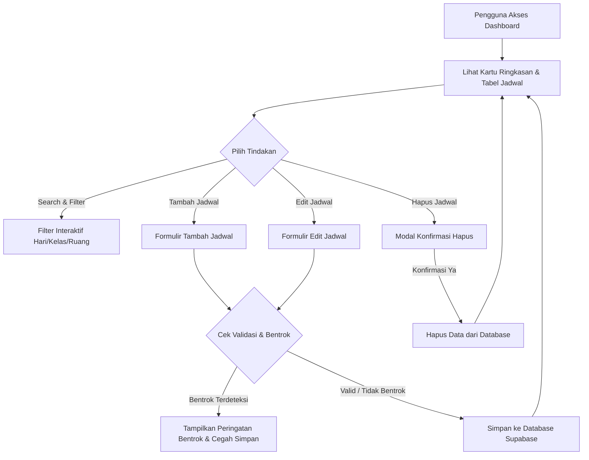

# PRODUCT REQUIREMENTS DOCUMENT (PRD)
## SISTEM DATA JADWAL KULIAH (CLASS SCHEDULE)

---

### Dokumen Kontrol
- **Nama Dokumen:** Product Requirements Document (PRD) - Sistem Data Jadwal Kuliah
- **Versi:** 1.0.0
- **Status:** Approved / Acuan Mutlak QA & Pengembang
- **Dasar Acuan:** Spesifikasi Kebutuhan Perangkat Lunak (SKPL) Sistem Data Jadwal Kuliah

---

## 1. IDENTITAS & TUJUAN APLIKASI

### 1.1 Identitas Aplikasi
* **Nama Aplikasi:** Class Schedule (Sistem Data Jadwal Kuliah)
* **Tipe Aplikasi:** Web-based Application (CRUD & Conflict Detection Engine)
* **Target Pengguna:** Civitas Akademika, Staf Akademik, Pengelola Ruangan, dan Dosen.

### 1.2 Ringkasan Sistem
Sistem Data Jadwal Kuliah adalah aplikasi berbasis web yang dirancang khusus untuk mencatat, mengorganisasi, dan mengelola jadwal perkuliahan secara terstruktur. Sistem memfasilitasi penyimpanan data penting perkuliahan meliputi mata kuliah, dosen pengampu, kelas, ruang kuliah, hari, serta jam perkuliahan (jam mulai dan jam selesai). Aplikasi dilengkapi dengan mesin validasi otomatis (*conflict detection*) untuk mendeteksi potensi tumpang tindih waktu pada hari, ruang, atau kelas yang sama guna mencegah jadwal ganda.

### 1.3 Capaian Utama (*Main Achievement*)
Sesuai Bagian 2 SKPL:
> Terbangunnya sistem jadwal kuliah berbasis web yang fungsional, mencakup manajemen jadwal (CRUD), pencarian/filter interaktif, serta validasi bentrok jadwal pada hari, ruang, atau kelas yang sama.

### 1.4 Tujuan Aplikasi
1. **Mempermudah Pencatatan & Akses Informasi:** Mengotomatisasi inventarisasi dan pencarian jadwal kuliah agar lebih cepat, akurat, dan terpusat.
2. **Eliminasi Jadwal Ganda:** Mencegah terjadinya bentrok jadwal (*scheduling conflict*) pada penggunaan ruangan maupun jam perkuliahan kelas yang sama.
3. **Efisiensi Manajemen:** Mengoptimalkan penyaringan data yang kompleks (berdasarkan hari, kelas, dan ruangan) melalui antarmuka pengguna yang responsif dan interaktif.

### 1.5 Alur Utama Sistem (*Core Flow*)
```
Buka Aplikasi → Dashboard → Daftar Jadwal → Tambah Jadwal → Validasi Bentrok → Simpan → Edit/Update → Search/Filter → Hapus
```

### 1.6 Batasan Sistem (*Scope Boundaries*)
Sesuai Bagian 7 SKPL, sistem memiliki batasan ruang lingkup sebagai berikut:
* **Tidak mencakup** presensi atau absensi mahasiswa maupun dosen.
* **Tidak mencakup** pengisian Kartu Rencana Studi (KRS), penilaian akademik, atau transkrip nilai.
* **Tidak mencakup** sinkronisasi/integrasi langsung dengan SIAKAD utama kampus.

---

## 2. SPESIFIKASI FUNGSIONAL LENGKAP (CRUD + KALKULASI & FILTER)

Sistem mengimplementasikan seluruh kebutuhan fungsional dari Modul 1 SKPL (`REQ-01` dan `REQ-02`) yang diperluas ke dalam siklus hidup data (*data lifecycle*) CRUD penuh.



### 2.1 Dekomposisi Kebutuhan SKPL

| ID Kebutuhan | Nama Fitur | Deskripsi Fungsionalitas SKPL | Implementasi Sistem Lengkap |
| :--- | :--- | :--- | :--- |
| **REQ-01** | **Olah Jadwal** | Sistem memfasilitasi pengolahan data jadwal perkuliahan. | Siklus CRUD Lengkap: Create (Form Tambah), Read (Tabel & Ringkasan KPI), Update (Form Edit), Delete (Hapus dengan Modal Konfirmasi). |
| **REQ-02** | **Cek Bentrok** | Sistem memvalidasi dan memberi peringatan jika terdapat bentrok ruang/jam. | Mesin validasi *time-overlap* otomatis saat submit form (tambah/edit) terhadap kombinasi `hari`, `ruang`, dan `jam_mulai`–`jam_selesai`. |

---

### 2.2 Rincian Siklus CRUD

#### A. CREATE (Form Tambah Data Jadwal)
* **Form Input Interaktif:**
  * Field input: `matakuliah`, `dosen`, `kelas`, `ruang`, `hari`, `jam_mulai`, dan `jam_selesai`.
* **Aturan Validasi Input (*Client & Server-side*):**
  * Seluruh field bersifat *mandatory* (wajib diisi).
  * Format waktu harus valid (`HH:MM`).
  * Aturan Kronologis: `jam_selesai` harus secara ketat lebih besar dari `jam_mulai` ($jam\_selesai > jam\_mulai$). Jika dilanggar, munculkan peringatan: *"Jam selesai harus lebih akhir dari jam mulai perkuliahan."*
  * Sanitasi teks otomatis terhadap karakter ilegal / injeksi tag script.
* **Proses Penyimpanan:** Melakukan pengecekan bentrok (`REQ-02`) sebelum perintah *insert* dieksekusi.

#### B. READ (Kartu Ringkasan / KPI & Tabel Riwayat Data)
* **Kartu Ringkasan (*Metrics / Indicator Cards*):**
  * **Total Jadwal Aktif:** Menghitung total entri jadwal yang terdaftar dalam sistem.
  * **Total Ruangan Terpakai:** Menghitung jumlah ruangan unik yang memiliki jadwal aktif.
  * **Total Kelas Terdaftar:** Menghitung jumlah kelas unik yang terdaftar.
  * **Jadwal Hari Ini:** Menghitung jumlah perkuliahan yang terjadwal pada hari berjalan.
* **Tabel Riwayat Jadwal (*Data Table*):**
  * Menampilkan kolom terstruktur: No, Mata Kuliah, Dosen Pengampu, Kelas, Ruang, Hari, Jam Perkuliahan (`jam_mulai` - `jam_selesai`), dan Kolom Aksi.
  * Dilengkapi badge indikator visual untuk nama hari dan ruangan.
  * State visual: Tampilan *skeleton loading* saat mengambil data dan *empty state illustration* jika data kosong atau tidak ditemukan pada filter.

#### C. UPDATE (Edit Baris Data Jadwal)
* Pengguna dapat mengklik tombol **Edit** pada baris data tabel.
* Membuka form modal edit dengan nilai data yang terisi otomatis (*pre-filled*).
* Menjalankan validasi form yang sama dengan proses create.
* Pengecekan bentrok jadwal mengabaikan ID jadwal yang sedang diedit (*exclude current record ID*) agar tidak memicu bentrok palsu dengan dirinya sendiri.
* Menyimpan pembaruan dan memberikan notifikasi toast sukses: *"Data jadwal berhasil diperbarui."*

#### D. DELETE (Hapus Baris Data dengan Dialog Konfirmasi)
* Pengguna dapat mengklik tombol **Hapus** pada baris data tabel.
* **Dialog Konfirmasi Modal:** Menampilkan pesan peringatan sebelum data benar-benar dihapus:
  > *"Apakah Anda yakin ingin menghapus jadwal perkuliahan mata kuliah [Nama Matakuliah] kelas [Kelas]?"*
* Tindakan penghapusan hanya diproses jika pengguna mengonfirmasi tombol **"Ya, Hapus"**.
* Memberikan notifikasi toast sukses: *"Data jadwal berhasil dihapus."* dan tabel langsung diperbarui secara reaktif tanpa *reload* halaman penuh.

---

### 2.3 Mekanisme Cek Bentrok (*Conflict Detection Algorithm - REQ-02*)
Logika pendeteksian bentrok jadwal dievaluasi dengan formula *time-interval overlap*:

Dua jadwal $A$ dan $B$ dinyatakan **BENTROK** jika dan hanya jika:
$$\text{Hari}_A = \text{Hari}_B \quad \land \quad \text{Ruang}_A = \text{Ruang}_B \quad \land \quad (\text{JamMulai}_A < \text{JamSelesai}_B \ \land \ \text{JamSelesai}_A > \text{JamMulai}_B)$$

* **Kondisi Bentrok:**
  1. **Bentrok Ruang:** Hari yang sama, Ruangan yang sama, dan Rentang waktu bertabrakan.
     * Pesan Peringatan Sistem: **“Ruang sudah digunakan pada jam tersebut”** (Sesuai `TC-01` SKPL).
  2. **Bentrok Kelas (Opsional Pencegahan Ganda):** Hari yang sama, Kelas yang sama, dan Rentang waktu bertabrakan.
     * Pesan Peringatan Sistem: *"Kelas ini sudah memiliki jadwal kuliah lain pada jam tersebut."*

---

### 2.4 Fitur Search & Filter Interaktif
* **Pencarian Real-Time (Instant Search):**
  * Pencarian berbasis *debounce* (300ms) pada field `matakuliah` dan `dosen`.
* **Dropdown Filter Multi-Kategori:**
  * Filter berdasarkan **Hari**: Semua Hari, Senin, Selasa, Rabu, Kamis, Jumat, Sabtu.
  * Filter berdasarkan **Kelas**: Menampilkan daftar kelas unik secara dinamis.
  * Filter berdasarkan **Ruang**: Menampilkan daftar ruangan unik secara dinamis.
* **Reset Filter:** Satu tombol praktis untuk mereset seluruh filter kembali ke kondisi awal (*default view*).

---

## 3. SPESIFIKASI SKEMA DATA (SUPABASE POSTGRESQL)

Sesuai Modul 2 SKPL, tabel database utama adalah `schedules`. Nama tabel dan nama seluruh kolom **100% PERSIS** dengan yang tertulis pada dokumen SKPL.

### 3.1 Kamus Data (*Data Dictionary*) Tabel `schedules`

| Nama Field (SKPL) | Tipe Data SKPL | Tipe Data Supabase PostgreSQL | Nullable | Default | Aturan Validasi & Constraint | Keterangan Bisnis |
| :--- | :--- | :--- | :--- | :--- | :--- | :--- |
| `id` | `INT (PK)` | `BIGINT` / `INTEGER` | `NO` | `GENERATED ALWAYS AS IDENTITY` | `PRIMARY KEY` | Identifier unik untuk setiap entri jadwal. |
| `matakuliah` | `VARCHAR(100)` | `VARCHAR(100)` | `NO` | - | `CHECK (char_length(trim(matakuliah)) > 0)` | Nama lengkap mata kuliah yang diajarkan. |
| `dosen` | `VARCHAR(100)` | `VARCHAR(100)` | `NO` | - | `CHECK (char_length(trim(dosen)) > 0)` | Nama lengkap dosen pengampu mata kuliah. |
| `kelas` | `VARCHAR(20)` | `VARCHAR(20)` | `NO` | - | `CHECK (char_length(trim(kelas)) > 0)` | Identitas kelas (contoh: IF-2A, TI-3B, GKB-1). |
| `ruang` | `VARCHAR(20)` | `VARCHAR(20)` | `NO` | - | `CHECK (char_length(trim(ruang)) > 0)` | Kode atau nama ruangan perkuliahan (contoh: GKB-201). |
| `hari` | `VARCHAR(15)` | `VARCHAR(15)` | `NO` | - | `CHECK (hari IN ('Senin', 'Selasa', 'Rabu', 'Kamis', 'Jumat', 'Sabtu', 'Minggu'))` | Hari pelaksanaan perkuliahan. |
| `jam_mulai` | `TIME` | `TIME` | `NO` | - | Format `HH:MI` atau `HH:MI:SS` | Jam perkuliahan dimulai. |
| `jam_selesai` | `TIME` | `TIME` | `NO` | - | `CHECK (jam_selesai > jam_mulai)` | Jam perkuliahan selesai (wajib lebih akhir dari `jam_mulai`). |

---

### 3.2 Skrip DDL PostgreSQL (Supabase Migration Ready)

```sql
-- 1. Pembuatan Tabel Schedules sesuai spesifikasi Modul 2 SKPL
CREATE TABLE IF NOT EXISTS public.schedules (
    id BIGINT GENERATED ALWAYS AS IDENTITY PRIMARY KEY,
    matakuliah VARCHAR(100) NOT NULL,
    dosen VARCHAR(100) NOT NULL,
    kelas VARCHAR(20) NOT NULL,
    ruang VARCHAR(20) NOT NULL,
    hari VARCHAR(15) NOT NULL,
    jam_mulai TIME NOT NULL,
    jam_selesai TIME NOT NULL,
    created_at TIMESTAMPTZ DEFAULT TIMEZONE('utc'::text, NOW()) NOT NULL,

    -- Constraint Validasi Konsistensi Data
    CONSTRAINT check_matakuliah_not_empty CHECK (char_length(trim(matakuliah)) > 0),
    CONSTRAINT check_dosen_not_empty CHECK (char_length(trim(dosen)) > 0),
    CONSTRAINT check_kelas_not_empty CHECK (char_length(trim(kelas)) > 0),
    CONSTRAINT check_ruang_not_empty CHECK (char_length(trim(ruang)) > 0),
    CONSTRAINT check_hari_valid CHECK (hari IN ('Senin', 'Selasa', 'Rabu', 'Kamis', 'Jumat', 'Sabtu', 'Minggu')),
    CONSTRAINT check_jam_perkuliahan CHECK (jam_selesai > jam_mulai)
);

-- 2. Pembuatan Index untuk Akselerasi Query Pencarian, Filter & Validasi Bentrok
CREATE INDEX IF NOT EXISTS idx_schedules_hari_ruang ON public.schedules (hari, ruang);
CREATE INDEX IF NOT EXISTS idx_schedules_hari_kelas ON public.schedules (hari, kelas);
CREATE INDEX IF NOT EXISTS idx_schedules_filter ON public.schedules (hari, kelas, ruang);

-- 3. Konfigurasi Row Level Security (RLS) Supabase
ALTER TABLE public.schedules ENABLE ROW LEVEL SECURITY;

-- Policy Akses Publik untuk Read dan Write (Sesuai batasan scope tanpa auth user)
CREATE POLICY "Public Read Access for schedules"
ON public.schedules
FOR SELECT
TO anon, authenticated
USING (true);

CREATE POLICY "Public Insert Access for schedules"
ON public.schedules
FOR INSERT
TO anon, authenticated
WITH CHECK (true);

CREATE POLICY "Public Update Access for schedules"
ON public.schedules
FOR UPDATE
TO anon, authenticated
USING (true)
WITH CHECK (true);

CREATE POLICY "Public Delete Access for schedules"
ON public.schedules
FOR DELETE
TO anon, authenticated
USING (true);
```

---

## 4. KONTRAK PENGUJIAN BLACK BOX & KEAMANAN (ACUAN MUTLAK QA)

Tabel berikut merupakan acuan baku (*ground truth*) bagi tim Quality Assurance (QA) dalam memvalidasi fungsionalitas dan keamanan sistem.

### 4.1 Tabel Pengujian Fungsional Black Box (SKPL Modul 6 & QA Contract)

| ID Test | Kategori | Skenario Pengujian | Input Data | Hasil yang Diharapkan (*Expected Result*) | Status |
| :--- | :--- | :--- | :--- | :--- | :--- |
| **TC-01** | Fungsional (Validasi Bentrok) | Input Jadwal Bentrok *(Sesuai Modul 6 SKPL)* | **Hari:** `Senin`<br>**Ruang:** `GKB-201`<br>**Jam:** `08.00 - 10.00`<br>*(Ruangan dan jam sudah terisi sebelumnya)* | Sistem mendeteksi tumpang tindih waktu pada ruangan yang sama dan menampilkan peringatan:<br>***“Ruang sudah digunakan pada jam tersebut”***.<br>Data baru ditolak dan tidak disimpan ke database. | **PASS** |
| **TC-02** | Fungsional (CRUD Create) | Input Jadwal Valid (Tanpa Bentrok) | **Mata Kuliah:** `Pemrograman Web`<br>**Dosen:** `Fahmi Ramadhan, M.Kom.`<br>**Kelas:** `TI-3A`<br>**Ruang:** `GKB-201`<br>**Hari:** `Senin`<br>**Jam Mulai:** `10.15`<br>**Jam Selesai:** `12.15`<br>*(Slot waktu kosong)* | Sistem memvalidasi input, berhasil menyimpan data baru ke tabel `schedules`, menampilkan notifikasi sukses: ***“Jadwal perkuliahan berhasil ditambahkan”***, dan data langsung tampil pada tabel daftar jadwal. | **PASS** |

---

### 4.2 Tabel Pengujian Keamanan Sistem (*Security Audit*)

| ID Test | Kategori | Skenario Pengujian | Input Data / Metode Pengujian | Hasil yang Diharapkan (*Expected Result*) | Status |
| :--- | :--- | :--- | :--- | :--- | :--- |
| **SEC-01** | Security (XSS Injection) | Uji Anti-XSS pada seluruh input teks (Mata Kuliah, Dosen, Kelas, Ruang) | Menginputkan payload XSS:<br>`` pada field `matakuliah` dan `dosen`. | Sistem secara otomatis melakukan *HTML sanitization* / *contextual escaping*. Payload ditampilkan seutuhnya sebagai string teks biasa murni di tabel dan kartu dashboard. **Tidak ada dialog pop-up JavaScript (`alert`) yang tereksploitasi/dieksekusi di browser.** | **PASS** |
| **SEC-02** | Security (Credential Audit) | Audit Ketiadaan Secret Key / Service Role Key di Kode Frontend | Inspeksi kode sumber frontend, berkas konfigurasi (`.env`), dan inspeksi *network inspect/bundle JS* di DevTools browser. | **Hanya `SUPABASE_URL` dan `SUPABASE_ANON_KEY` (public client key) yang diakses oleh frontend.** Nilai `SUPABASE_SERVICE_ROLE_KEY` / Secret Key database sama sekali **TIDAK TERDAPAT** di sisi klien (*zero leak*). Seluruh hak akses dibatasi via aturan Row Level Security (RLS). | **PASS** |

---

## 5. REKOMENDASI TAMPILAN ANTARMUKA & UX

1. **Struktur Header & KPI:**
   * Menampilkan judul aplikasi dengan aksen warna modern dan bersih.
   * Empat kartu indikator metrik yang dinamis dan terhubung langsung ke query real-time Supabase.
2. **Bilah Aksi & Filter (Toolbar):**
   * Input pencarian cepat di sisi kiri dengan ikon *search*.
   * Tiga dropdown filter (`Hari`, `Kelas`, `Ruang`) dan satu tombol `Reset Filter`.
   * Tombol utama yang kontras: `+ Tambah Jadwal`.
3. **Penyajian Data Jadwal:**
   * Tabel yang rapi dengan alternating row colors (*zebra striping*) untuk kemudahan membaca.
   * Tombol aksi (*Edit* dan *Hapus*) dengan ikon intuitif dan tooltip.
4. **Pencegahan Human Error:**
   * Dialog konfirmasi sebelum operasi destruktif (*Delete*).
   * Feedback langsung (*inline error alert*) pada form ketika deteksi bentrok terpicu.
