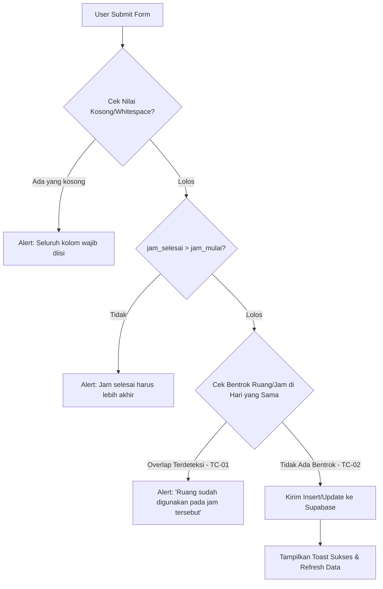

# AI CODING & SECURITY GUARDRAILS (`RULES.md`)
## SISTEM DATA JADWAL KULIAH (CLASS SCHEDULE)

---

### Dokumen Kontrol
- **Nama Dokumen:** AI Coding & Security Guardrails
- **Versi:** 1.0.0
- **Status:** Mandatory / Hukum Wajib bagi AI Coding Assistant & Developer di IDE (VS Code)
- **Tujuan:** Menjamin integritas skema database, keamanan dari eksploitasi XSS/kebocoran kredensial, dan kepatuhan mutlak terhadap kontrak QA.

---

> [!IMPORTANT]
> Seluruh instruksi dalam dokumen ini bersifat **MUTLAK (NON-NEGOTIABLE)**. Setiap baris kode yang ditulis oleh AI Coding Assistant di VS Code wajib mematuhi seluruh guardrail di bawah ini tanpa pengecualian.

---

## 1. KEPATUHAN SKEMA DATA & SPESIFIKASI SKPL

AI dilarang mengubah, menerjemahkan, atau mengimprovisasi nama tabel, kolom, maupun teks pesan validasi di luar yang telah ditetapkan dalam `PRD.md` dan Modul SKPL.

### 1.1 Skema Tabel & Kolom (100% Identik)
* **Nama Tabel:** Wajib persis `schedules` (huruf kecil, plural).
* **Nama Kolom:**
  1. `id` : Primary key (integer/bigint).
  2. `matakuliah` : Nama mata kuliah (string/varchar 100).
  3. `dosen` : Nama dosen pengampu (string/varchar 100).
  4. `kelas` : Identitas kelas (string/varchar 20).
  5. `ruang` : Identitas ruang kuliah (string/varchar 20).
  6. `hari` : Hari perkuliahan (string/varchar 15; nilai: `'Senin'`, `'Selasa'`, `'Rabu'`, `'Kamis'`, `'Jumat'`, `'Sabtu'`, `'Minggu'`).
  7. `jam_mulai` : Jam mulai (time; format `HH:MM`).
  8. `jam_selesai` : Jam selesai (time; format `HH:MM`).
* **Larangan Keras:** 
  * ❌ DILARANG menggunakan bahasa Inggris untuk kolom (seperti `subject`, `lecturer`, `classroom`, `day`, `start_time`, `end_time`).
  * ❌ DILARANG mengubah gaya penulisan menjadi camelCase (seperti `jamMulai`, `mataKuliah`). Wajib snake_case persis: `jam_mulai`, `jam_selesai`, `matakuliah`.

### 1.2 Ketetapan Kalimat Pesan Error Validasi
* Pesan bentrok waktu ruangan (`TC-01`) **WAJIB 100% PERSIS**:
  > **“Ruang sudah digunakan pada jam tersebut”**
* ❌ DILARANG mengganti kalimat ini menjadi kalimat lain (seperti *"Ruangan bentrok"*, *"Jadwal bertabrakan"*, *"Room is already booked"*).

---

## 2. ATURAN MUTLAK ANTI-XSS (`SEC-01`)

Sistem harus kebal terhadap serangan Cross-Site Scripting (Stored XSS maupun Reflected XSS). Seluruh data yang bersumber dari input pengguna (*user input*) maupun database Supabase harus diperlakukan sebagai **DATA TIDAK TERPERCAYA (UNTRUSTED DATA)**.

### 2.1 Larangan Keras (*Prohibited Patterns*)
* ❌ **DILARANG KERAS** menyisipkan data variabel secara langsung ke dalam DOM menggunakan:
  * `.innerHTML`
  * `outerHTML`
  * `document.write()`
  * Inline event handler berbasis string (seperti `onclick="hapusJadwal('${data.id}')"` jika parameter string tidak di-escape).

### 2.2 Pola Implementasi Wajib (*Enforced Secure Patterns*)
AI wajib menggunakan salah satu atau kombinasi dari dua pendekatan aman berikut:

#### Pendekatan A: DOM Manipulation dengan `.textContent` (Sangat Direkomendasikan)
Gunakan `document.createElement()` dan selalu gunakan properti `.textContent` (bukan `.innerHTML`) untuk mencetak teks:

```javascript
// ✅ POLA AMAN (SECURE): Menggunakan textContent
function renderJadwalRow(jadwal) {
  const tr = document.createElement('tr');
  tr.className = 'border-b border-slate-200 hover:bg-slate-50';

  const tdMatkul = document.createElement('td');
  tdMatkul.className = 'px-4 py-3 font-medium text-slate-900';
  tdMatkul.textContent = jadwal.matakuliah; // AMAN dari XSS!

  const tdDosen = document.createElement('td');
  tdDosen.className = 'px-4 py-3 text-slate-700';
  tdDosen.textContent = jadwal.dosen; // AMAN dari XSS!

  // Append sel ke baris
  tr.appendChild(tdMatkul);
  tr.appendChild(tdDosen);
  return tr;
}
```

#### Pendekatan B: Fungsi Sanitasi `escapeHtml()` (Jika Menggunakan Template Literals)
Jika terpaksa menggunakan template literals untuk membangun markup, **WAJIB** membungkus setiap variabel dengan fungsi sanitasi ketat:

```javascript
// ✅ HELPER SANITASI RESMI (Wajib Disertakan)
function escapeHtml(str) {
  if (str === null || str === undefined) return '';
  return String(str)
    .replace(/&/g, '&amp;')
    .replace(/</g, '&lt;')
    .replace(/>/g, '&gt;')
    .replace(/"/g, '&quot;')
    .replace(/'/g, '&#039;');
}

// Penggunaan pada Template Literal:
const rowHtml = `
  <tr>
    <td class="px-4 py-3">${escapeHtml(jadwal.matakuliah)}</td>
    <td class="px-4 py-3">${escapeHtml(jadwal.dosen)}</td>
  </tr>
`;
```

---

## 3. ATURAN MUTLAK VALIDASI INPUT & CEK BENTROK (`TC-01` & `TC-02`)

Keamanan dan integritas data tidak boleh hanya bergantung pada validasi HTML5 bawaan (seperti atribut `required`, `min`, `max`), karena atribut tersebut dapat dihapus dengan mudah oleh pengguna melalui *DevTools / Inspect Element*.

### 3.1 Validasi Logika Tingkat Aplikasi (*JavaScript Pre-Submission Validation*)
Sebelum memanggil client Supabase (`supabase.from('schedules').insert(...)`), AI wajib menjalankan rantai validasi logika secara terstruktur:

1. **Pemeriksaan Field Kosong / Whitespace:**
   ```javascript
   if (!matakuliah.trim() || !dosen.trim() || !kelas.trim() || !ruang.trim() || !hari.trim()) {
     showError("Seluruh kolom formulir wajib diisi!");
     return;
   }
   ```
2. **Validasi Kronologis Jam Perkuliahan:**
   ```javascript
   if (jam_selesai <= jam_mulai) {
     showError("Jam selesai harus lebih akhir dari jam mulai perkuliahan.");
     return;
   }
   ```
3. **Validasi Bentrok Jadwal Ruangan (`TC-01`):**
   * Ambil data jadwal yang ada pada `hari` dan `ruang` yang sama dari database (atau dari state cache lokal yang sinkron).
   * Lakukan evaluasi tumpang tindih waktu (*time overlap*):
     $$\text{Overlap} \iff (jam\_mulai_{baru} < jam\_selesai_{lama}) \land (jam\_selesai_{baru} > jam\_mulai_{lama})$$
   * Jika overlap terdeteksi:
     1. **BATALKAN** proses pengiriman ke database.
     2. Tampilkan pesan peringatan resmi pada *Alert Banner*:
        > **“Ruang sudah digunakan pada jam tersebut”**
     3. Kembalikan state tombol submit ke kondisi normal (bukan loading).

### 3.2 Diagram Logika Validasi



---

## 4. ATURAN KEAMANAN KREDENSIAL & ENV (`SEC-02`)

Aplikasi ini berjalan sebagai aplikasi web client-side murni (*SPA / static single page application*). Oleh karena itu, batasan eksposur kredensial harus dijaga dengan sangat ketat.

### 4.1 Kredensial yang Diizinkan di Frontend
* `SUPABASE_URL` : URL endpoint project Supabase publik.
* `SUPABASE_ANON_KEY` : Kunci anonim publik Supabase yang dibatasi oleh Row Level Security (RLS).

### 4.2 Larangan Keras (*Strict Prohibitions*)
* ❌ **DILARANG KERAS** menuliskan atau menyisipkan `SUPABASE_SERVICE_ROLE_KEY` (secret key) ke dalam file `index.html`, script JavaScript, maupun file publik apapun.
* ❌ **DILARANG KERAS** menyisipkan API Key pihak ketiga lainnya (seperti `STITCH_API_KEY`, AI service secret keys, atau admin database connection strings).
* **Alasan Keamanan:** `service_role` key memiliki akses bypass penuh terhadap seluruh aturan Row Level Security (RLS) PostgreSQL. Jika secret key ini bocor di frontend, seluruh isi database dapat dibaca, diubah, atau dihapus oleh pihak luar secara ilegal.

---

## 5. RINGKASAN VERIFIKASI SEBELUM KODE DIANGGAP SELESAI (*FINAL GATE*)

| No | Poin Pemeriksaan Guardrail | Status Wajib |
| :---: | :--- | :---: |
| 1 | Tabel bernama `schedules` dengan kolom: `id`, `matakuliah`, `dosen`, `kelas`, `ruang`, `hari`, `jam_mulai`, `jam_selesai`. | **WAJIB** |
| 2 | Pesan bentrok berbunyi persis: **“Ruang sudah digunakan pada jam tersebut”**. | **WAJIB** |
| 3 | Tidak ada baris kode `.innerHTML` yang mengekspos variabel tanpa `escapeHtml()`. | **WAJIB** |
| 4 | Validasi form JavaScript mengecek nilai kosong dan bentrok sebelum memanggil API. | **WAJIB** |
| 5 | Hanya `SUPABASE_URL` dan `SUPABASE_ANON_KEY` yang digunakan di client-side. | **WAJIB** |
| 6 | Tombol submit memiliki animasi loading spinner saat menunggu respon Supabase. | **WAJIB** |
| 7 | Modal konfirmasi muncul sebelum baris jadwal dihapus. | **WAJIB** |
